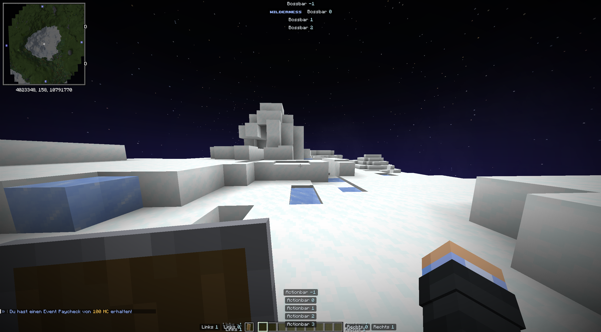
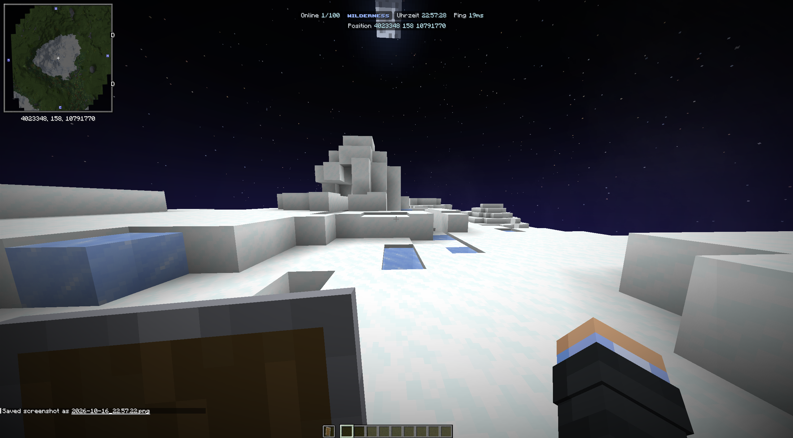
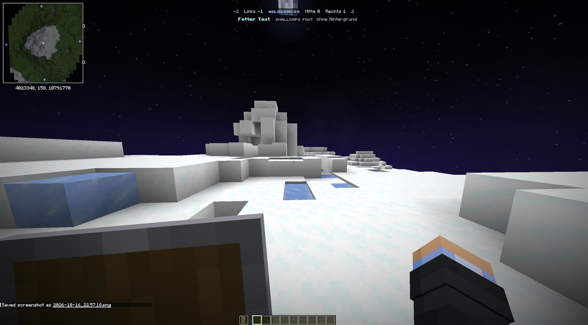

# surf-hud

Pill-styled HUD elements in the boss bar and action bar, positioned with fonts from the
surf-hud resource pack (no core shaders). Runs on Paper (`surf-hud-paper`) and Minestom
(`surf-hud-minestom`); plugins only depend on `surf-hud-api`.

## Setup

```kotlin
repositories {
    maven("https://reposilite.slne.dev/releases")
}

dependencies {
    compileOnly("dev.slne.surf.hud:surf-hud-api:1.0.1")
}
```

Install `surf-hud-paper` or `surf-hud-minestom` on the server and send players the
surf-hud resource pack.

## Usage

```kotlin
player.hud.add {
    line(0) {                                   // boss bar, line 0
        element("online", -1, online)           // left of the center
        center("clock", clock)
        element("ping", 1, ping)                // right of the center
    }
    actionBar(-1) { center("position", position) }
    hotbarRight(-1) { center("server", Component.text("DEV")) }
}

player.hud.content("clock", newClock)           // update one element
player.hud.remove("ping")
player.hud.visible = false
```

- `id` identifies an element; adding the same id again replaces it.
- `position` orders the elements of a line: `0` is the anchor, lower values go left, higher
  values go right (beside the hotbar: further away from it).
- `background = false` drops the pill behind an element.
- Lines count downwards in every slot, so negative lines are above line 0. Lines without a
  font in the `HudTheme` are not shown.

## Display slots

| `DisplaySlot` | Builder | Lines | Where |
|---|---|---|---|
| `BOSSBAR` | `line(n)` | `-1` … `2` | top of the screen, centered (default slot) |
| `ACTIONBAR` | `actionBar(n)` | `-1` … `3` | `0` is the action bar, `-1` above it, `1` … `3` below it |
| `HOTBAR_LEFT` | `hotbarLeft(n)` | `-1` … `1` | left of the hotbar; `0` is centered on it, `-1` / `1` are text rows in its upper / lower half without background by default |
| `HOTBAR_RIGHT` | `hotbarRight(n)` | `-1` … `1` | right of the hotbar, mirroring `HOTBAR_LEFT` |

The hotbar slots keep room for the offhand slot when it is shown on their side, which
depends on the player's main hand.

## Screenshots

| | |
|---|---|
|  |  |
| All slots and lines | Boss bar |
|  |  |
| Action bar | Positions and styles |
|  | |
| Text rows beside the hotbar | |
